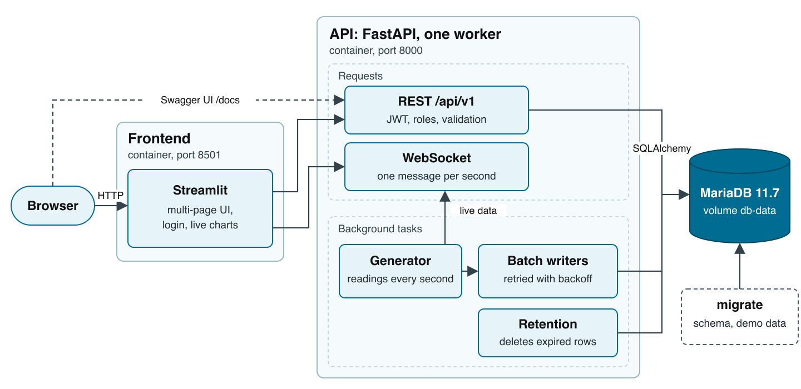

# Design

Why the system is built this way, what I measured, and where its limits are. The [README](../README.md) explains how to run it.

Contents: [Key decisions](#key-decisions) · [Layout](#layout) · [Real-time pipeline](#real-time-pipeline) · [Permissions](#permissions) · [Failure handling](#failure-handling) · [Database access](#database-access) · [Streamlit](#streamlit) · [Middleware](#middleware) · [Deployment and migrations](#deployment-and-migrations) · [Capacity](#capacity) · [Scaling, up and out](#scaling-up-and-out) · [API overview](#api-overview) · [Before production](#before-production) · [Known limits](#known-limits)

## Key decisions

- **One API process simulates, broadcasts and stores the telemetry.** The target is one burn-in line: 200 servers, 10,000 readings/s, 20 viewers. I measured how far one process goes instead of estimating it ([Capacity](#capacity)).
- **Writes are batched and safe to retry.** A unique key per reading blocks duplicate rows; an `Idempotency-Key` makes record creates and imports safe to send twice.
- **Defined failure behavior.** Database-dependent REST requests answer `503` during a database outage; `/health/live` remains independent of the database. New WebSockets close with `1013`, open connections stay open, and generation pauses when the last confirmed 30-second lease expires ([Failure handling](#failure-handling)).
- **Shared settings at runtime.** Admins change thresholds, the warning level, the interface language and the plant time zone without a restart. Stations on a line are shared, so these are one setting for everyone, not a per-user switch.

## Layout



The diagram is rendered from [architecture.svg](architecture.svg).

```text
backend/app/
  api/         routers and dependencies (auth, roles, paging)
  services/    business logic and ORM queries
  models/      SQLAlchemy models
  schemas/     Pydantic request and response models
  core/        settings, security, errors, time helpers
  db/          engine, pool, session, error classification
backend/alembic/   the initial migration
frontend/
  app.py       login gate and role-based navigation
  views/       one file per page
  lib/         API client, session state, WebSocket thread
load/          k6 and fleet scripts behind the capacity numbers
```

Routers call services; services raise application errors that `main.py` maps to HTTP. The running stack uses two networks: `backend` (MariaDB, API, migrate) and `frontend` (API, Streamlit), so Streamlit cannot reach the database. The tests use a third, `test`.

Each simulated server has 50 sensors in seven metrics (the API calls a metric `category`):

| Metric | Sensors per server | Alert threshold |
| --- | --- | --- |
| `chamber_temp` | 2 | 45 °C |
| `cpu_temp` | 2 | 90 °C |
| `gpu_temp` | 8 | 85 °C |
| `dimm_temp` | 16 | 85 °C |
| `nvme_temp` | 8 | 70 °C |
| `fan_rpm` | 10 | 3,000 RPM, alerts when below (a failing fan slows down) |
| `power_w` | 4 (per supply) | 2,700 W |

These are demonstration settings, not validated safety limits for a particular server model. A real line would use product specifications and the BMC's per-sensor thresholds.

## Real-time pipeline

Every second the generator creates one reading per server and sensor: 1,000 readings/s for the demo's 20 servers (`REALTIME_SERVERS` changes the fleet size). Each consumer gets only what it needs.

**Dashboards** get one WebSocket message per second, serialised once per tick, not once per client: per metric the count, average, minimum, maximum, alerts and the reading nearest the limit, plus the newest alerts. For fleets of up to 200 servers it also lists each server's sensor nearest the limit per metric, so the live page can colour every server. 200 is one line and the largest grid the page draws; beyond it the list would keep growing in a message every viewer receives each second, so it is left out:

| Servers | Message size |
| --- | --- |
| 20 | 14 KB |
| 200 | 117 KB |
| 201 or more (per-server list left out) | 4 to 6 KB |

A page that opens late fills its charts from `/realtime/summary`; server details come from `/realtime/latest`.

**The database** gets every raw reading through a batch writer. It writes every 10 seconds, or sooner when 1,000 readings wait, in chunks of 5,000 rows, up to four chunks in parallel, each in its own transaction. The chunk size matters: the driver builds each INSERT in Python while the event loop waits, and one statement for a large backlog froze the ticks for seconds.

**Analytics** read per-minute statistics (count, sum, minimum, maximum and alerts per metric), written once a minute, so a fleet chart never scans raw readings. A single server's statistics come from its raw readings through the unique index. Live ranges count only finished minutes; an Excel report freezes that range once for all four sheets. Each minute contribution carries a receipt, so a retried write does not count twice. After acquiring the generator lease, the holder rebuilds the last two hours of completed minutes from stored raw readings in the background. The minute containing its startup is excluded, so recovery cannot replace its new contributions. Before applying repairs, the transaction locks and verifies the current lease; another process does not repair this holder's statistics. Late raw commits require another recovery within that window; expired or dropped raw data cannot be recovered.

**Alert events.** Each reading past its limit is flagged in its raw row and counted in the tick summary. The live alert list samples at most 50 anomalous readings per tick, so it is not a complete alarm ledger. An alert that lasts at least three consecutive readings is also stored as one event per server and sensor, with its start, end and peak, through the same kind of batch writer and unique key. Events are kept 30 days; engineers and admins can acknowledge them, and the first confirmation (who and when) is kept.

**Retention.** A job runs every minute and deletes raw readings older than 12 hours, alert events older than 30 days, system logs older than 14 days and idempotency keys older than 24 hours, at most 20,000 rows per transaction. It picks rows by id range, not by time: a delete by time alone was planned as a full table scan once most rows had expired, and it stopped the batch writer. While the writer is behind, the raw-reading purge pauses (up to 10 minutes), so new readings come first.

**Settings.** Thresholds, the warning level (default 90% of the limit), language and time zone live in two tables, filled from `.env` once. A change applies from the next tick; each reading stores the threshold it was compared with, so stored alerts keep their meaning. The API re-reads the tables every 30 seconds to pick up changes made through another instance.

## Permissions

- FastAPI dependencies check the role on every protected route; the service layer checks record ownership.
- The token carries no role: the role is read from the database on every request, so a demotion or a deactivation applies to the next request.
- Logout ends every session of that user: each token carries the user's token version, which logout, a password reset and a deactivation increment. An open WebSocket re-checks the token and account every 30 seconds.
- A wrong password, an unknown user and a deactivated account get the same answer; the reason goes to the system log.
- The last active admin cannot be demoted or deactivated; the check locks the admin rows, so two admins demoting each other at the same moment cannot both succeed.
- Unknown query parameters and body fields answer `422`, so a typo never passes silently.
- bcrypt hashing (and Excel generation) run in a thread pool, so a burst of logins does not stall the telemetry stream.

## Failure handling

### Disconnections

The development record reports the following connection-interruption experiments (for the database: MariaDB stopped for 40 to 45 seconds). These historical observations were not all repeated in the latest correction cycle; unit tests and current smoke results are identified separately in [TESTING.md](TESTING.md).

| Connection | What happens | Observed |
| --- | --- | --- |
| API to MariaDB, database-dependent REST | `503` with `Retry-After: 5`; `/health/live` stays available | Historical observation: `503` within 20 ms; `200` on the first request after |
| API to MariaDB, batch writes | Failed chunks go back to memory and are retried with backoff | 0 dropped, 0 duplicated |
| API to MariaDB, open WebSocket | The connection stays open and the account re-check is retried. Ticks pause once the generator cannot confirm its database lease for 30 s, and resume after | Connection kept; unit tests cover the lease pause |
| API to MariaDB, new WebSocket | Accepted, then closed with `1013` (try again later) | Close code `1013` |
| Streamlit to API | REST times out after 15 s with a message; the WebSocket thread reconnects with backoff (1 s to 10 s) and refills missed ticks from `/realtime/summary` | Unit tests |
| Client to API, lost response | The client resends with the same `Idempotency-Key` and gets the stored result | A 2,000-row import retried twice was stored once |
| Slow WebSocket client | Its oldest queued messages are dropped instead of growing memory | Unit test |
| API stops | The generator stops, buffers are flushed (bounded), then the pool closes | Newest stored reading from the stop second |
| API crashes | Readings still in memory are lost, normally under 10 s | Not tested |

Why `1013` and not a refusal: a refusal before the handshake reaches the client as HTTP 403, which looks like a bad token, and Streamlit would log the user out.

**When a batch write fails**, the chunks go back in front of newer readings and the writer backs off exponentially (base 1 s, capped at 30 s, with jitter). The next attempt writes one chunk first, so a database that is coming back is not hit by the whole backlog. The total budget holds 500,000 readings (about 50 s at the target), including queued and in-flight items. When full, the oldest queued items are dropped and counted; if all capacity is in-flight, incoming items are dropped instead. Diagnostics expose queued, in-flight and total pending separately. A row the database rejects is isolated by retrying the chunk row by row.

**Generator authority** expires from the start of the last successful lease request, so a slow reply does not extend its TTL. Renewal operations have a deadline; an independent watchdog stops generation at expiry even if renewal cancellation is still cleaning up. Each tick also checks expiry before generating, including the first tick after an event-loop stall. These local deadlines assume comparable host clocks; the application does not claim fenced writes across arbitrary clock skew or process suspension.

### Which database errors mean "try again"

The driver reports a lost connection, a lock timeout and a bug all as `OperationalError`, so the API classifies by MariaDB error number:

| Error | Examples | API answer |
| --- | --- | --- |
| Cannot connect, connection lost, pool exhausted | 2003, 2006, 2013, 1040 | `503`, `Retry-After: 5` |
| Another transaction changed the data first | 1020, 1205, 1213 | `409`, `Retry-After: 1` |
| The database refuses a value | `DataError` | `422` |
| Anything else, such as an unknown column | 1054 | `500`, logged with a traceback, because it is a bug |

Logs show the error class and number, never the bound values.

### Retried batches must not create duplicates

Sometimes the database commits a batch but the reply is lost; the writer then sends it again. A unique key makes the second write harmless. I measured three index layouts on a separate MariaDB, writing 3 million rows in 5,000-row chunks over 4 connections, twice in opposite orders:

| Layout | Rows/s, whole run | Same chunk sent twice |
| --- | --- | --- |
| Plain insert, no unique key | 76,759 and 87,239 | stored twice |
| A separate unique key on server, metric, time | 41,860 and 45,547 | stored once |
| **The existing (server, time) index made unique, with metric (and later sensor) added** | 71,463 and 65,197 | stored once |

The third layout is used: about 17% slower inserts instead of 46%, and server/time queries still use its first two columns. The writer uses a plain ORM bulk insert; when a retried chunk hits the key (error 1062), it reads which readings are already stored and inserts only the missing ones. No database-specific upsert is needed.

### Creates and imports that are sent twice

`POST /records` and `POST /records/import` accept an optional `Idempotency-Key`. The first request stores its response in the same transaction as the records. While the key is retained, the same user, key and body reuse the stored response (`Idempotent-Replayed: true`); a different body with that key answers `409`. Keys become eligible for cleanup after 24 hours; a retry after cleanup can create new records. Two concurrent requests with one key produce one result: the later commit fails on the key and returns the first. Streamlit sends a key with every create and import and keeps it while the same content is retried. Each import file is one transaction: one bad row rejects that file, not the others. Validation checks all rows and returns the first 50 errors with the total error count.

## Database access

**SQLAlchemy sessions.** Services use `AsyncSession` over asyncmy for reads, transactions and bulk writes. Query filters, ordering, paging and locking are expressed with SQLAlchemy; schema migrations use Alembic.

**Checked query plans.** Because the ORM writes the SQL, I captured the statements of the real service functions and ran `EXPLAIN` on them with about 5 million readings. Two fixes came out of it: telemetry history is ordered and paged by `(generated_at, id)` with a keyset cursor, so "up to a time" uses the time index instead of walking the primary key backwards (one page took 1.35 s on 3 million rows before the change); and the alerts-only filter is written `== true()` because SQLAlchemy's `is_(True)` produces `IS true`, which MariaDB does not match with an index (111–153 ms down to 7 ms).

**Precision.** Values are `DOUBLE`; MariaDB's `FLOAT` would return 12345.678 as 12345.7. A test checks values come back exactly.

**Connection pool.** 10 connections plus 20 overflow, pre-ping, recycled after 30 minutes. A request waits at most 10 s for a connection, then gets `503`: shorter than Streamlit's 15 s timeout, so the user sees a retry message rather than a timeout. A larger pool (30 + 50) did not help under full load (287 against 315 requests/s): the CPU is the limit, not the pool.

## Streamlit

- **WebSocket thread.** Streamlit reruns the page script, so the script cannot hold a socket. Each session runs a small background thread that keeps the WebSocket open; the live page reads its buffer once a second with `st.fragment`. The thread stops two minutes after its last reader.
- **Shared work.** The live page builds charts and tables once per tick in a shared cache, so each extra viewer only pays for sending them.
- **Two defaults changed**, the main cost at a one-second refresh: `runner.postScriptGC` (a full garbage collection after every rerun; 60% of the frontend CPU with 20 viewers) is off, and chart data sits inside the Vega-Lite spec, because Streamlit only redraws a chart whose data changes shape.
- **Staying logged in.** A page script stores the JWT in a `SameSite=Strict` cookie that expires with the token; a new tab validates it with `/auth/me`. An authenticated API `401` ends the session; a cookie rejected by `/auth/me` with `401` or `403` is cleared. An ordinary authorization `403` refreshes the role without discarding a valid login. Logout clears the cookie; an unreachable API does not.
- **Session state.** Logout clears everything the pages stored. Filters and page numbers survive navigation between pages. A `403` makes the page reload the role from `/auth/me`, so the menu follows a role change without a new login.
- **Language and time zone.** Every UI text is English in the code and looked up in `frontend/lib/i18n.py`; pages are identified by URL, not title, so role checks do not depend on the language. Times are shown and entered in the plant's time zone and sent with their offset; the database stores UTC.

## Middleware

| Layer | Used | Why |
| --- | --- | --- |
| Request context | yes | An `X-Request-ID` on every request and every log line; method, path, status, duration and user go to `system_logs` (health checks, the docs, live polling and successful `/auth/me` checks are left out). |
| Import size limit (ASGI) | yes | Answers `413` near 2 MB while the body arrives, also without `Content-Length`. |
| Exception handlers | yes | One JSON error shape with the request ID; internal details never reach the client. |
| GZip | yes | JSON lists shrink 11 to 13 times. |
| Authentication | a dependency, not middleware | Per-route, so public routes need no exception list and Swagger shows which routes need a token. |
| CORS | no | No browser calls the API from another origin; Streamlit calls it server-side. |
| Rate limiting, TLS | no | Belong to the gateway or reverse proxy (see [Known limits](#known-limits)). |

## Deployment and migrations

The assignment starts from a fresh database: one Alembic revision, `0001`, creates the complete schema. A one-shot Compose `migrate` service runs it, creates missing demo accounts and imports the sample records; the API starts only after it succeeds and never migrates or seeds itself. Re-running it is safe. Dependencies are pinned (`constraints.txt` for every transitive one) and the base images are pinned by digest.

## Capacity

**Target:** one burn-in line of about 200 servers, 10,000 readings/s, watched by 20 people. The assignment gives no numbers, so I derived them:

- **200 servers.** At Wiwynn's Juárez plant an automated line assembles about 60 servers a day and a manual line about 100 ([CommonWealth Magazine](https://english.cw.com.tw/article/article.action?id=5018)). With 1 to 2 days of burn-in each (my assumption), one line has 60 to 200 servers in burn-in at once. The target takes the upper end.
- **Sensors.** A real BMC reports dozens to hundreds of sensors, sampled every 1 to 60 seconds. What the system feels is servers × sensors ÷ interval: 50 sensors a second × 200 servers = 10,000 readings/s.
- **Retention.** 12 hours of raw readings, enough to investigate an alert; per-minute statistics are kept.

**Measured.** `load/fleet.sh N` restarts the API with N servers, waits 20 seconds, then samples the writer counters for 60 seconds; 20 k6 WebSocket clients (`load/ws.js`, 20-second sessions) measured the ticks each client received. Apple M3, Docker Desktop with 8 CPUs and 7.75 GB, database and API only, 3-minute retention so the purge runs; measured on an earlier revision of this code. CPU is the median of `docker stats` samples, as a percentage of one core.

| Servers | Configured readings/s | Writer counter/s | Dropped | Ticks/s per client | API CPU | MariaDB CPU |
| --- | --- | --- | --- | --- | --- | --- |
| 20 (demo) | 1,000 | 1,000 | 0 | 1.00 | 3% | 1% |
| 100 | 5,000 | 5,000 | 0 | 1.00 | 15% | 9% |
| 200 (target) | 10,000 | 10,000 | 0 | 1.00 | 22% | 14% |
| 400 | 20,000 | 20,000 | 0 | 1.00 | 36% | 28% |

The historical run reported an empty queued buffer at the final sample; its older pending counter excluded in-flight writes. Configured rate is not a measurement of actual generated ticks, and writer counters are not an independent audit of durable database rows. Raw benchmark output and the exact measured commit are not included here. Larger fleets and a full 12-hour table (432 million readings at the target) were not tested. The historical REST run reported 285 to 315 requests/s on one worker (95th percentile 12 ms at 200 requests/s); ten logins a second used about 3.5 cores. These results establish earlier-revision behavior on that machine, not a production capacity guarantee for this revision.

**With real numbers**, in this order: get the real figures (servers, sensors, interval, how long raw data must be kept for traceability); replace the generator with a collector that reads each BMC through Redfish or IPMI and sends batches (the unique key already makes a resent batch safe); load-test at full table size on production-like hardware; then partition or move raw telemetry if needed.

## Scaling, up and out

| Part | Bigger machine | More instances |
| --- | --- | --- |
| MariaDB | Helps most: memory keeps the indexes in the buffer pool. | Partition by time or move raw telemetry to a time-series database; analytics can read from a replica. |
| API: simulation, broadcast, writes | Measured headroom to 20,000 readings/s on one process. | Needs the broadcaster and buffers out of the process (for example Redis pub/sub and a queue); the database lease allows one generator per database. |
| API: REST | More workers once the broadcaster moves out. | Any number behind a load balancer: identity comes from the JWT, the role from the database. |
| Streamlit | More CPU for more viewers. | Sessions live in process memory: sticky sessions at the load balancer. |
| Database connections | | MariaDB's default 151 connections fit about five API instances at 30 each. |

The current retention strategy inserts each reading and later deletes expired rows in chunks. Partitioning or a time-series store should be evaluated against full-retention load and operational requirements.

## API overview

The full schemas are in Swagger (`/docs`). *Any* means any logged-in user.

| Method | Path | Who |
| --- | --- | --- |
| POST | `/api/v1/auth/register`, `/api/v1/auth/login` | public |
| GET | `/api/v1/auth/me` | any |
| POST | `/api/v1/auth/logout` | any; ends all of that user's sessions |
| GET | `/api/v1/records`, `/api/v1/records/{id}`, `/api/v1/records/categories` | any |
| POST | `/api/v1/records`, `/api/v1/records/import` | user, admin; optional `Idempotency-Key` |
| PATCH, DELETE | `/api/v1/records/{id}` | the owner or an admin |
| GET | `/api/v1/realtime/latest`, `/summary`, `/alerts`, `/config`, `/alert-events` | any |
| PATCH | `/api/v1/realtime/alert-events/{id}` | user, admin: acknowledge |
| WS | `/api/v1/ws/realtime` | any; token in `Authorization: Bearer` (or `?token=`) |
| GET | `/api/v1/analytics/summary`, `/categories`, `/trend`, `/export` | any |
| GET, POST | `/api/v1/admin/users` | admin: list, create an account with any role |
| PATCH | `/api/v1/admin/users/{id}` | admin: role and active status |
| PUT | `/api/v1/admin/users/{id}/password` | admin: reset, ending that user's sessions |
| GET | `/api/v1/admin/logs`, `/db-status`, `/realtime/history` | admin |
| GET, PATCH | `/api/v1/admin/settings` | admin: change only the fields sent |
| GET | `/api/v1/settings/display` | public: language and time zone for the login page |
| GET | `/health`, `/health/live` | public |

### API errors

HTTP errors use `{"detail": "...", "request_id": "..."}` with an optional `errors` list for field or row problems. Responses carry `X-Request-ID`.

| Status | When | What the client does |
| --- | --- | --- |
| `401` | No token, or a bad, expired or ended one | Log in again; Streamlit ends the session |
| `403` | The role or ownership does not allow it | Not retryable; Streamlit re-reads the role |
| `404` | No such record, user or alert event | Not retryable |
| `409` | A write conflict, an idempotent request still in progress, a reused key with a different body, a duplicate username | Retry after `Retry-After` when present; otherwise change the request |
| `413` | An import over 2 MB | Split the file |
| `422` | Validation: a bad or unknown field, a malformed file (with row numbers), an unknown metric or time zone | Fix the request |
| `500` | A bug; logged with a traceback | Not retryable; the `request_id` in the body finds the traceback in the API log (`docker compose logs api`) |
| `503` | The database cannot be reached | Retry after `Retry-After: 5`; Streamlit offers *Try again* |

WebSocket close codes: `1008` the token or account is no longer valid (log in again); `1012` the API is restarting; `1013` try again later, sent to a new connection while the database is down and to a client that has not taken a message for 10 s. Streamlit reconnects on its own for `1012` and `1013`.

## Before production

This is a take-home run with Docker Compose on one machine. A real line would need:

- **Backups** of users, records, minute statistics, logs and settings (raw readings can be left out), with a tested restore.
- **Secrets** from the platform (Docker secrets, Kubernetes, a secret manager) instead of `.env`; the API warns while `JWT_SECRET` is the placeholder.
- **Monitoring** of the numbers on the database status page (write buffer, drops, pool use) in a metrics system with alerts.
- **TLS, access and rate limiting** at a reverse proxy in front of Streamlit and the API.

## Known limits

- **One API worker.** The broadcaster and write buffers are in process memory; a second worker can serve REST but has no fleet to push. See [Scaling](#scaling-up-and-out).
- **Crash loss.** Readings still in memory are lost if the process crashes, normally under 10 seconds.
- **No login or registration rate limit, no lock-out.** Registration gives the Viewer role only.
- **Login cookie.** Set by page script, so it cannot be `HttpOnly`. It is `SameSite=Strict`, and a token expires after 8 hours, one shift.
- **WebSocket token in the URL.** Browsers cannot set WebSocket headers, so `?token=` is also accepted; a proxy that logs URLs would record it.
- **Retention at full size untested.** A 12-hour table at the target rate was not load-tested; see [Capacity](#capacity).
- **Alert rules.** One threshold per metric for every sensor and server model; a real collector would use the BMC's per-sensor thresholds.
- **Size limits.** Imports up to 2 MB and 5,000 rows per file; single-server live analytics up to a 3-hour range; the Excel data sheet up to 50,000 raw rows (the summary says when it is truncated).
- **MariaDB only.** Trend buckets use MariaDB date functions inside ORM expressions.
- **No automated browser E2E suite.** The UI is covered by Streamlit AppTest with a mocked API and the [manual checklist](TESTING.md).
